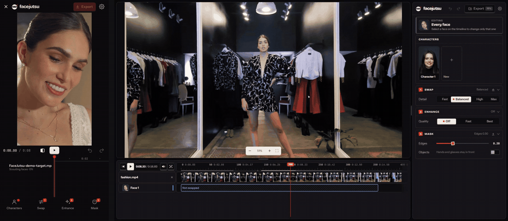
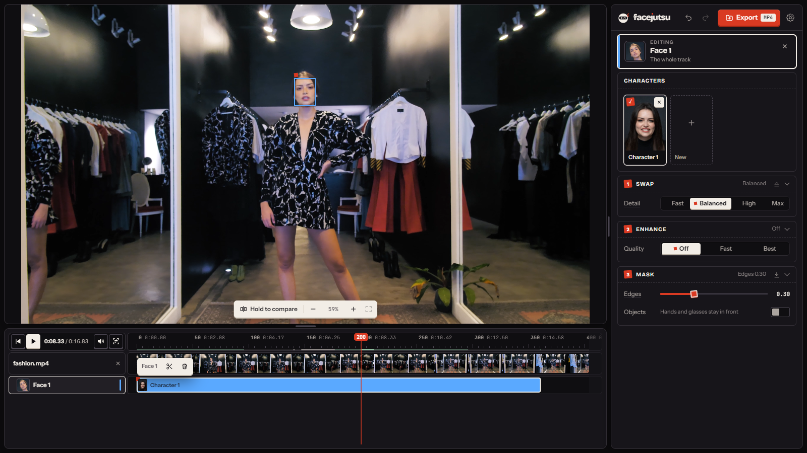
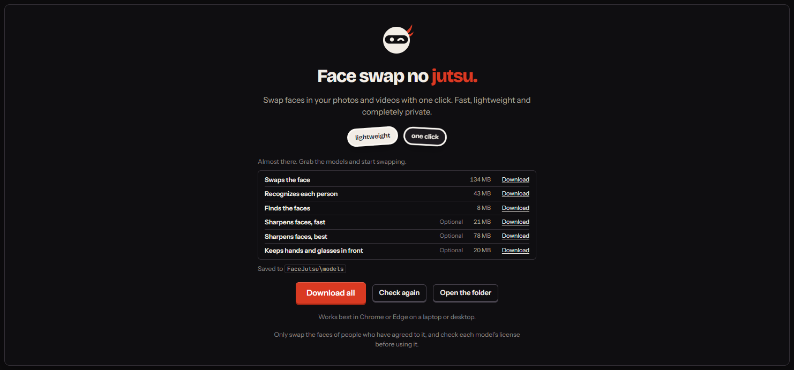

# FaceJutsu

**Face swap no jutsu.** Swap faces in your photos and videos with one click, right on your own computer. Fast, lightweight and completely private: your files never leave your machine.

## What it does

- **Photos and videos:** swap one face or everyone in the shot, and keep the original audio.
- **Characters:** make a character from a photo and reuse it whenever you like.
- **A real editor:** each person gets a track on the timeline, so you can split, trim and change who appears when.
- **Live preview:** see the result as you edit, and the export reuses what the preview already made.
- **Hands and glasses stay in front:** objects covering a face can stay on top of the swap.
- **Private by design:** everything runs on your own graphics card. There are no accounts and nothing is uploaded.

## Get started

1. Download `FaceJutsu-windows-x64.zip` from the [latest release](../../releases/latest).
2. Unzip it somewhere with room to spare, and open `FaceJutsu.exe`.
3. Windows warns about new apps it doesn't recognize: choose **More info**, then **Run anyway**.
4. The app opens in your browser. Choose **Download all** to fetch the models, then start swapping.

You'll need a recent version of **Chrome or Edge** and a computer with a graphics card. Keep the FaceJutsu window open while you work.

## Your files

Everything stays in the folder next to the app:

| Folder or file | What's in it |
| --- | --- |
| `outputs` | your finished photos and videos |
| `models` | the model files |
| `data` | your characters, your edits and swapped frames kept to save time |
| `config.toml` | settings, such as the port and where the models come from |

## Models

FaceJutsu doesn't come with any models. The start page lists what's needed and downloads it for you. If a link ever stops working, put the file in the `models` folder yourself, or change its address in `config.toml`.

| File | What it does | |
| --- | --- | --- |
| `scrfd-10g.bf16.safetensors` | finds the faces | needed |
| `arcface-r50.int8.safetensors` | recognizes each person | needed |
| `inswapper-128.int8.safetensors` | swaps the face | needed |
| `gpen-bfr-256.int8.safetensors` | sharpens faces, fast | optional |
| `gpen-bfr-512.int8.safetensors` | sharpens faces, best | optional |
| `xseg.int8.safetensors` | keeps hands and glasses in front | optional |

Each model has its own license, which is yours to check before using it or what you make with it. Some are for non-commercial research only, and one states no license:

- **inswapper_128, SCRFD, ArcFace:** [InsightFace](https://github.com/deepinsight/insightface), non-commercial research license
- **Face enhancer:** [GPEN](https://github.com/yangxy/GPEN) (Yang et al.), no stated license
- **Occlusion mask:** community-trained XSeg, on the architecture of [DeepFaceLab](https://github.com/iperov/DeepFaceLab) (GPL-3.0)

## Use it responsibly

Only swap the faces of people who have agreed to it. Don't use FaceJutsu to deceive, harass or impersonate anyone, or to make sexual images of anyone without their consent, or of minors at all. What you make and share is your responsibility.

## License

FaceJutsu is provided as is, without warranty of any kind. The open source software it's built with is listed in the app, under **Storage & about**, then **Open source licenses**.
